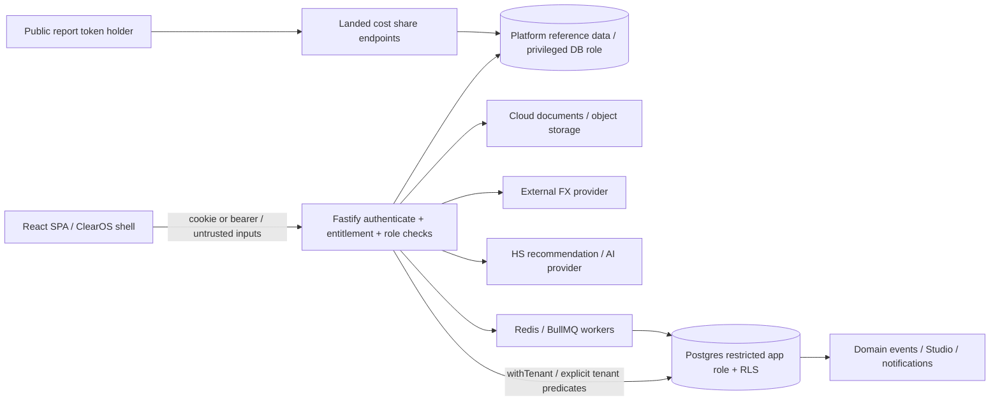

# Architecture and trust boundaries

Scope owner modules: ClearOSShell (navigation/roles), pages/CommandCenter and ShipmentDetail (clearance), customs.routes/customs.service and advanced-calculators.service (estimates), declarations.routes/declaration.service (TANSAD), sanctions.service (screening), origin-rules.service (origin), shared auth/entitlement/DB/Cloud/Studio services. Shared types live in packages/types. packages/ui and api-client are not the live frontend conventions.

Failure consequences: Postgres affects all persistence; auth/entitlements affect every screen; Redis affects async processing; Cloud failure can leave issued documents without mirrors; FX affects financial estimates; sanctions source freshness affects compliance decisions; AI errors affect suggestions and require human confirmation. Privileged dbPlatform use is a separate trust boundary, not protected by ordinary RLS.

Repository-wide package manifests, deploy/contabo and CI were inventoried as shared dependencies. Other business apps, all worker paths, circular dependencies and complete ownership assignments remain NOT VERIFIED. API source inventory: evidence/api-inventory.json (108 definitions across five route files; relative paths, not a complete runtime OpenAPI export). Routes/pages: evidence/page-inventory.json.
