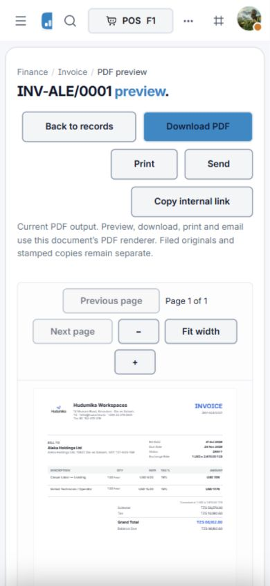

# FinOps document experience implementation — 23 October 2026

Implements the shared interaction and output layer described in [the review](DOCUMENT_EXPERIENCE_REVIEW_2026-10-23.md). The review describes the earlier state; this document describes the implemented changes and the verification limits.

## Implemented

- Stable create, record and edit routes for the applicable finance document screens, with real record links for opening multiple records in browser tabs. Vendor profiles and expense reports retain their existing dedicated routes.
- Shared FormPage headers and actions, session draft recovery for controlled finance fields, reload protection and explicit discard confirmation on form Cancel/Back. Drafts are scoped by tenant, user and route; receipt file selections are not persisted. Ordinary sidebar navigation preserves drafts rather than blocking navigation.
- Shared Preview PDF, Download PDF, Print and Send actions. Preview uses the server PDF through the existing Cloud PDF.js renderer. Download saves those fetched PDF bytes. Printing renders those same PDF pages for the browser print dialog, with blocked-window/error fallback.
- Sending explicitly queues a freshly generated PDF attachment. It does not claim that the email was delivered, or that regenerated bytes are an immutable copy of the preview. Delivery history reads the actual email outbox. Concurrent retries with the same request key queue one message.
- Common output API for invoices, credit notes, quotations, purchase orders, delivery documents, bills, expense vouchers, expense reports and vendor statements. Access is authenticated, tenant scoped, entitlement and role gated; expense report owner restrictions are enforced. Procurement scope applies to purchase-order output.
- Existing document template registry extended to bills, vouchers, reports and statements. Shared company identity, embedded logo selection, configured accent and supported PDF font handling; repeated table headings and page numbering added to continuation pages.
- Screen invoice amounts retain native line currency and two-decimal precision matching the PDF; quotation document amounts no longer silently use the reporting-currency formatter.
- Vendor statements generated as server PDFs, replacing unescaped HTML interpolation. Statements separate balances by currency and exclude draft/void bills. Claim reports are itemized reports; receipt originals remain in the authorized app.
- Purchase-order status-only action now says Mark as sent. Actual email is a separate reviewed, queued operation. Purchase-order form labels now describe orders.
- Explicit all-record CSV export for all nine areas, limited to 10,000 accessible records. Existing selected/current-page exports are labelled. Shared CSV escaping neutralizes formula-leading text and preserves numeric negatives.
- Selected invoice PDF download produces one ZIP, with per-record failure summary. Shared batch API supports all nine kinds, at most 30 records and 25 MB. It does not trigger multiple automatic popup downloads.

## Verification

- `npm run typecheck`: passed, including both applications, event trigger checks, 19 design-system checks and encoding check.
- Finance regression run: **six suites / 15 tests passed**, no skips. Covers shared output and access restrictions, real PDF attachments and concurrent retry idempotency, partial ZIP failures, expense report flows, invoice totals, invoice payment-link access and document filing.
- Existing document-template and large-invoice layout tests: **two suites / four tests passed**.
- CSV text safety tests: **two tests passed**.
- All nine generated PDF first pages rendered with Poppler and visually inspected using disposable test data. Invoice, quotation, PO, bill and credit-note fixtures include line items. Claim and vendor statement fixtures exercised empty states. Large existing invoice/delivery fixtures exercise pagination separately.
- Browser: invoice record link, actual PDF preview and named PDF download verified; PDF.js preview rendered at 390px. Delivery form was checked at 390px without horizontal overflow, and entered draft text survived reload; Cancel displayed discard confirmation and cleared the test draft. Purchase-order, bill and quotation creation routes rendered their full-page forms. The session subsequently locked; remaining signed-in browser journeys are not claimed as verified.
- Final shared-output rerun: **one suite / one comprehensive test passed**, including successful CSV responses for every kind, PDF responses for all nine kinds, tenant and role isolation, mixed batch failures and concurrent email idempotency. This reruns the shared-output test already included in the 15-test regression count; it is not an additional distinct test.
- Frontend typecheck passed again after the final clipboard error handling and saved-record navigation changes.
- `npm run build`: passed for types, UI package, API and web. Vite reports an existing large-chunk warning (including the Three.js vendor bundle); this is a performance warning, not a failed build.
- `git diff --check` passed; line-ending notices also refer to unrelated concurrent work, which was left untouched.

Logs in the workspace: `finance-document-root-last.log`, `finance-document-regression-final.log`, `finance-document-output-export-final.log`, `finance-document-layout-final.log`, `finance-document-export-ui-tests-final.log`, `finance-document-build-last.log`. These are local verification artifacts, not deployed release evidence. The final root typecheck was repeated successfully after concurrent Industry Templates changes; those unrelated changes were left untouched.

## Boundaries and remaining acceptance

- This is a current-output workflow. Existing filed originals, signed/stamped copies and accounting lifecycle rules remain distinct. Changing branding can change a newly generated preview; this work does not add immutable snapshot version selection to the preview.
- CSV all-record scope is explicitly independent of active list filters. Filter-aware export jobs, XLSX and a combined PDF are not implemented. Batch selection UI is currently provided on invoices; the common API supports the other document kinds.
- Email provider delivery, physical printer behavior and the complete role/browser matrix still require environment acceptance. Queued mail is not delivery evidence. No real customer email was sent during verification.
- Uploaded embedded logos are supported; arbitrary remote logo URLs are intentionally not fetched by the server. PDF fonts without embedded support retain the existing Helvetica fallback.
- Not every original detail page was rebuilt into one identical shell. Shared actions, stable routes and form headers are implemented while preserving domain-specific approvals, receipts, receiving and payment workflows.
- No deployment, production release approval or universal production-readiness claim is made by these results.

