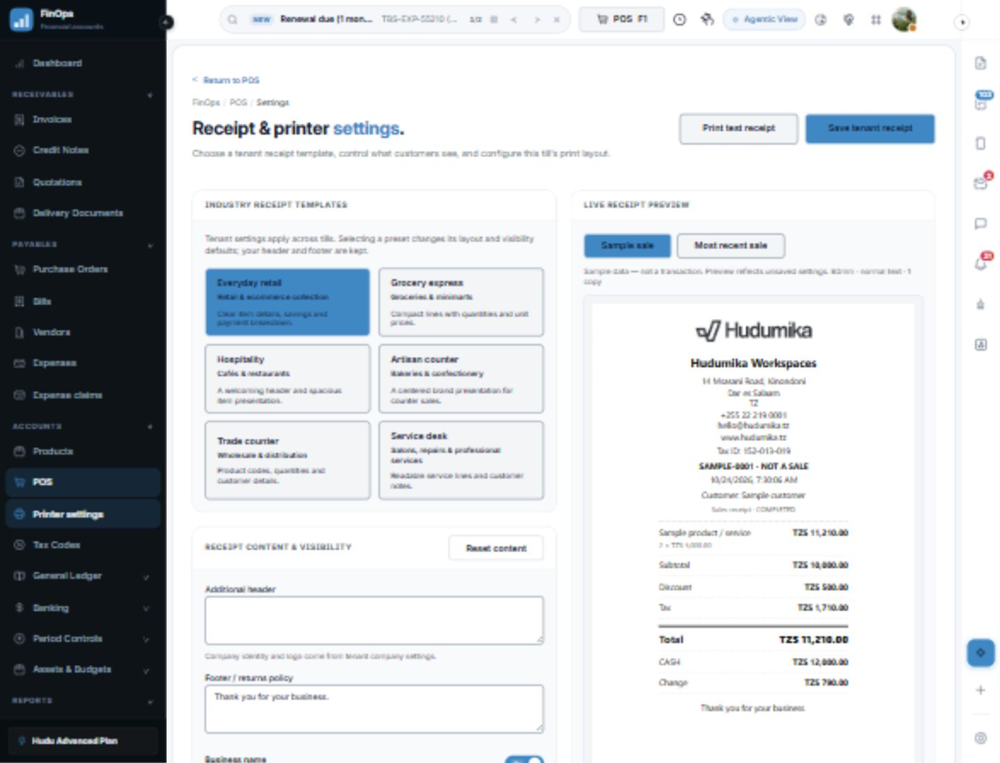
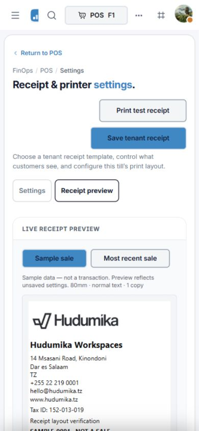
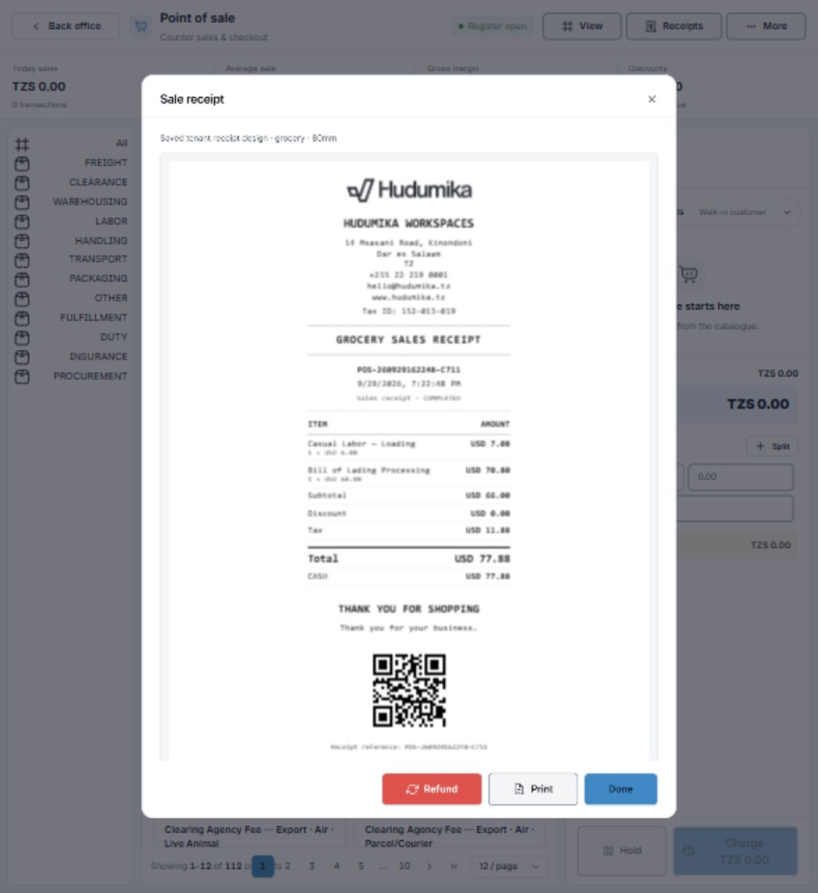

# POS receipt and printer settings — 24 October 2026

The POS settings page now separates tenant receipt policy from local printer preferences.

## Tenant receipt settings

Workspace administrators select six presets: Everyday retail, Grocery express, Hospitality, Artisan counter (bakery/confectionery), Trade counter (wholesale), and Service desk. These are receipt presentation presets for recorded POS sales, not new industry operating modules.

Presets have distinct layout treatments and sensible field defaults. Tenants can customize additional header/footer text and visibility of company name/logo, contact details, tax ID, receipt number, date, customer name, product codes, unit prices, subtotal, discount, tax, payment methods, change and sale notes. Item names, quantities, grand total, currency and sale status stay visible.

Settings are saved to the existing tenant settings API under `posReceipt`. The server validates supported template IDs, bounded text and boolean visibility fields. Existing settings authorization restricts tenant changes to workspace administrators. No new table or migration is required.

Company identity is read from the current tenant settings for printing; cached company identity is not used to populate another tenant's receipt. Receipt settings and latest-sale preview data are cleared on tenant/account change, and outstanding latest-sale requests are cancelled.

## Local printer settings

Each browser/account/tenant retains its own paper format (58 mm, 80 mm or A4), text size, margins, copy count and automatic print-dialog preference. Two-copy mode marks the second copy as a duplicate. Existing customer/footer preferences are used as a legacy fallback until an administrator saves the tenant profile.

Browser printing uses printers installed or paired on the computer. Destination, driver paper configuration and physical margins are controlled in the browser/OS print dialog. This implementation does not claim direct ESC/POS access, silent printing, printer discovery or cash-drawer control.

## Output and preview

The live preview, test receipt and completed-sale printing use the same HTML receipt renderer. Preview supports clearly identified sample data or an explicitly requested most recent sale. Editing a preview does not modify sale records. Receipt content is HTML-escaped, executable logo URLs are rejected, and the preview iframe is sandboxed without scripting privileges.

Printing waits briefly for fonts and images before opening the browser dialog, reports startup failures, and cleans up its temporary iframe. Automatic printing is isolated from checkout completion: a printer failure cannot turn a saved sale into an apparent failed checkout.

The page uses Hudumika PageHeader, SectionCard, Button, Select, Textarea, SwitchRow, Banner and loading components. SwitchRow's existing shared component now associates its visible label and description with its switch for assistive technology.

## Verification

- Frontend tests: two suites, nine tests passed (receipt escaping, privacy visibility, supported templates, paper width/copies, invalid local settings, legacy settings, and existing date-range checks).
- API integration test: passed against disposable tenants; checks round-trip persistence, cross-tenant isolation, unsupported templates, oversized text, non-boolean/unknown visibility fields and manager write rejection.
- Final `npm run typecheck` passed for both applications, event trigger validation, the design-system contract (19 checks) and encoding. `git diff --check` passed.
- Browser: verified wholesale preset selection, product-code defaults, customer-name hiding, custom header updates, 58 mm paper selection, duplicate-copy marking and actual latest-sale loading. A minimum page-size mismatch discovered in the latest-sale query was fixed and retested successfully.
- Mobile: 390px document width matched the viewport, with no horizontal overflow in the settings/preview panels. Smaller screens use Settings/Receipt preview tabs; desktop shows both panels side by side. Saved tenant/device preferences were not changed by browser verification. Preview controls were restored after testing.
- `npm run build`: passed for shared types, UI package, API and web. Vite retains an existing large-chunk warning for the application/vendor bundles.
- Physical printer output still depends on local hardware and driver acceptance; no real sale or financial transaction is created by the test receipt.

Local verification logs: `pos-receipt-web-tests.log`, `pos-receipt-api-tests.log`, `pos-receipt-web-final.log`, `pos-receipt-api-check.log`, `pos-receipt-design-check.log`, `pos-receipt-encoding-check.log`, `pos-receipt-build.log`.

## Saved-design adoption follow-up

The POS sale dialog previously retained an independent, hardcoded receipt layout. It now displays the same receipt document as settings preview and printing. Opening a receipt reads the saved tenant profile; manual and automatic printing re-fetch the profile and the sale, so old and new sales both use the current saved customization and status. Settings failures block output rather than silently substituting a default design. The dialog refreshes settings on focus and after a same-window settings save; switching tenant/account closes the old receipt.

Receipt layouts now include thermal-style headings, column labels and separators, an editable receipt heading and closing heading, brand/monospace typography, and optional QR encoding of the actual receipt number. QR is a receipt reference, not a public verification or payment link. Masked card numbers, authorization codes, loyalty balances and customer birth dates from reference mockups are not fabricated.

The script-disabled receipt preview automatically measures content height so the dialog owns the scrolling. The document layout remains monochrome for thermal paper; physical printer decoration is not printed. Roll paper uses the printer driver's page size with the configured content width and margins.

Browser acceptance: saved a grocery preset with custom headings, monospace typography, QR reference and hidden customer name; reloaded settings to confirm persistence; opened the existing POS-260929162248-C711 sale and confirmed every customization in the sale dialog. The dialog fit a 390px viewport (left 16px, right 374px) without document overflow. Restored the previous retail preset after verification. No sale, refund or payment was created.

Tests: 11 frontend tests passed across three suites, including uncached saved-profile adoption for historical/new receipt data and failure handling; the API integration test passed with the new fields, tenant isolation and malformed-option rejection. Final typecheck/build results are recorded in `pos-receipt-design-web-final.log`, `pos-receipt-design-api.log` and `pos-receipt-design-build.log`.

The full production build passed; shared types were also rebuilt after the final normalization adjustment. Final `npm run typecheck` passed for both apps, event triggers, all 19 design-system checks and encoding (`pos-receipt-design-root-final.log`). Vite reports the existing large vendor-bundle warning. Physical printer and QR scanner acceptance remain hardware checks.

